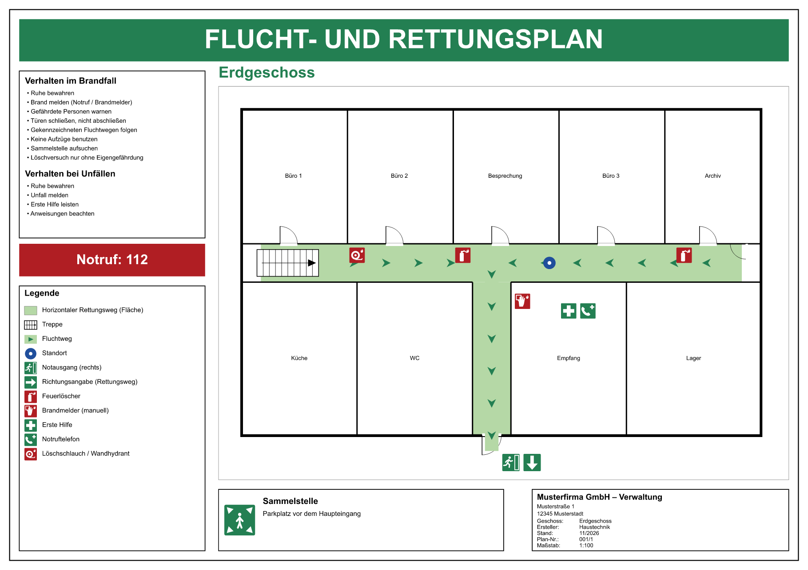

# OpenFluchtplan

**Freie Software zum Erstellen von Flucht- und Rettungsplänen nach ISO-Normen**: eine einzige
`.exe`, ohne Installation, ohne Lizenzkosten.



| Planart | Norm |
|---|---|
| Flucht- und Rettungspläne | DIN ISO 23601 |
| Feuerwehrpläne (Übersichts-, Geschoss-, Sonderpläne) | DIN 14095 |
| Feuerwehr-Laufkarten | DIN 14675 |
| Brandschutzpläne | Feuerwiderstandsklassen, Brandabschnitte |
| Brandschutzordnung Teil A | DIN 14096 |

## Funktionen

- **Zeichnen:** Wände, Räume, Türen, Fenster, Treppen, Fluchtwege mit automatischen Pfeilen,
  Flächen nach DIN 14095, Brandschutzklassen REI 30/60/90, Planraster, Geschoss-Schnitt, Maßstab
- **Symbolbibliothek mit über 220 Zeichen:** Rettungs-, Brandschutz-, Warn-, Gebots- und
  Verbotszeichen (in Anlehnung an ISO 7010), Feuerwehrplan-Symbole (DIN 14034-6), GHS,
  Brandmeldetechnik; eigene SVG-Symbole importierbar
- **Automatische Legende**, mehrsprachig (DE, EN, FR, IT, ES, PL, TR, NL)
- **Normprüfung:** Standort, Fluchtwege, Sammelstelle, Legende, Format, Zeichengröße …
- **Import:** PDF als bearbeitbare Vektorgrafik (z. B. vorhandene CAD-Pläne, Symbole werden erkannt),
  Bilder, DXF; OpenStreetMap und amtliche Karten (WMS/ALKIS) für Übersichtspläne
- **Export:** PDF (vektoriell, mit Stempel ENTWURF/MUSTER), PNG, SVG, DXF; mehrere Pläne in einem PDF
- **Automatisierung:** Kommandozeile (`--cli`) und MCP-Server (`--mcp`) für KI-Assistenten wie
  Claude: Pläne per Chat bearbeiten, das offene Fenster lädt Änderungen live nach

Die vollständige Anleitung steht in [docs/Bedienungsanleitung.md](docs/Bedienungsanleitung.md).

## Download und Start

Die fertige `OpenFluchtplan.exe` liegt unter [Releases](../../releases). Herunterladen und starten,
auch vom Netzlaufwerk oder USB-Stick. Es werden keine Laufzeitumgebung und keine
Administratorrechte benötigt. Läuft unter Windows 10/11 und Windows Server.

## Selbst bauen

Voraussetzung: [Rust](https://rustup.rs) (stable) und unter Windows die MSVC Build Tools.

```
cargo build --release
cargo test --release
```

Die exe liegt danach unter `target/release/OpenFluchtplan.exe`.

Aufbau des Codes (`src/`):

| Datei | Inhalt |
|---|---|
| `model.rs` | Datenmodell (Plan, Objekte, Ebenen, Stile) |
| `render.rs`, `canvas.rs` | Darstellung |
| `tools.rs`, `ui.rs`, `dialogs.rs`, `app.rs` | Bedienoberfläche (egui) |
| `ops.rs`, `geom.rs` | Geometrie, Treffer, Transformationen |
| `symbols.rs` | Symbolbibliothek (SVG) |
| `templates.rs`, `presets.rs` | Planrahmen, Flächenvorlagen |
| `pdfvec.rs`, `import.rs`, `export.rs` | PDF-Vektorimport, Import, Export |
| `pruefung.rs` | Normprüfung |
| `schnittstelle.rs` | Kommandozeile und MCP-Server |
| `osm.rs`, `wms.rs` | Kartendienste |
| `tests.rs`, `ui_tests.rs` | Tests (die Oberflächentests laufen ohne Bildschirm) |

## Mitmachen

Verbesserungen sind willkommen, gern als Pull Request. Hinweise dazu stehen in
[CONTRIBUTING.md](CONTRIBUTING.md). Fehler und Wünsche bitte als
[Issue](../../issues) melden.

## Entstehung und Lizenz

Der Code wurde vollständig von der KI **Claude** (Anthropic) geschrieben, im Auftrag und nach den
Vorgaben eines IT-Administrators, der damit die Pläne seines Unternehmens selbst pflegen wollte.
Niemand beansprucht Rechte an diesem Code. Soweit doch Rechte bestehen sollten, sind sie mit der
[Unlicense](LICENSE) aufgegeben: Jeder darf den Code ohne Bedingungen nutzen, ändern, weitergeben und
verkaufen, auch ohne Quellenangabe.

Ohne Gewähr: Die Pläne ersetzen keine fachliche Prüfung durch Brandschutzbeauftragte oder die
Brandschutzdienststelle. Normtexte sind nicht enthalten. Die Symbole sind eigene Darstellungen in
Anlehnung an die genannten Normen. Wo amtliche Originalgrafiken vorgeschrieben sind, können sie
als SVG eingebunden werden.

Verwendete Bibliotheken: siehe `Cargo.toml` (überwiegend MIT/Apache-2.0). Kartendaten:
© OpenStreetMap-Mitwirkende (ODbL) bzw. Nutzungsbedingungen des jeweiligen WMS-Dienstes.

---

## English

**OpenFluchtplan** is a free, portable Windows application for creating evacuation and escape plans
(ISO 23601), German fire brigade plans (DIN 14095) and fire alarm route cards (DIN 14675). It has
a CAD-like editor, a library of more than 220 safety signs, an automatic multilingual legend,
compliance checks, a PDF-to-vector import for existing plans, and PDF/PNG/SVG/DXF export.
It also offers a command line and an MCP server, so plans can be edited by AI assistants.
The user interface is German. The code was written entirely by Claude (Anthropic) and is released
into the public domain under the Unlicense. Contributions, including translations, are welcome.
